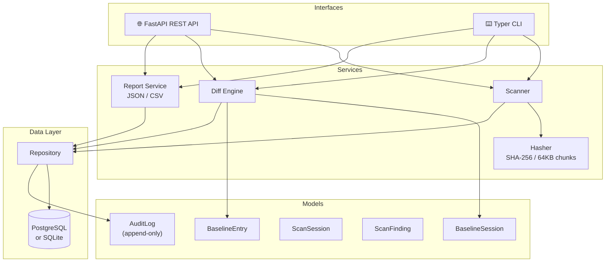

<div align="center">

# 🛡️ FIM-Sentinel

**File Integrity Monitoring & Forensics Tool**

[](https://www.python.org/)
[](https://fastapi.tiangolo.com/)
[](https://www.sqlalchemy.org/)
[](https://github.com/hasancrlk/fim-sentinel/actions/workflows/ci.yml)
[](LICENSE)
[](Dockerfile)

*Enterprise-grade file integrity monitoring with forensic audit trails, REST API, and CLI.*

</div>

---

## 📋 Table of Contents

- [Overview](#overview)
- [Architecture](#architecture)
- [Chain of Custody](#-chain-of-custody)
- [Quick Start](#-quick-start)
- [CLI Usage](#-cli-usage)
- [API Usage](#-api-usage)
- [Docker Deployment](#-docker-deployment)
- [Testing](#-testing)
- [Configuration](#%EF%B8%8F-configuration)
- [Project Structure](#-project-structure)
- [Contributing](#-contributing)

---

## Overview

FIM-Sentinel monitors file systems for unauthorized changes by creating cryptographic baselines and detecting modifications, additions, and deletions. Every operation is recorded in an **append-only audit log** to maintain forensic integrity.

### Key Features

| Feature | Description |
|---|---|
| 🔐 **SHA-256 Streaming Hash** | 64 KB chunk-based hashing — handles GB+ files without RAM spikes |
| 🔄 **Diff Engine** | Detects `MODIFIED`, `ADDED`, `DELETED` changes vs. baseline |
| 📝 **Append-Only Audit Log** | Immutable forensic trail — records are never deleted or updated |
| 🐘 **PostgreSQL + SQLite** | Production PostgreSQL with SQLite fallback for development |
| 🌐 **REST API** | FastAPI with OpenAPI docs, JSON/CSV export |
| ⌨️ **CLI** | Typer-based CLI with Rich terminal output |
| 🐳 **Docker Ready** | Multi-stage build with docker-compose (app + PostgreSQL) |
| 🛡️ **Graceful Error Handling** | Symlink loops & permission errors are logged, never crash |

---

## Architecture



---

## 🔗 Chain of Custody

> **Why does this matter?**
>
> In digital forensics and incident response, **chain of custody** proves that evidence has not been tampered with. FIM-Sentinel enforces this through:
>
> 1. **Cryptographic Hashes** — Every file's SHA-256 digest is recorded at baseline time.
> 2. **Append-Only Audit Log** — All operations (baseline creation, scans) are logged with timestamps. Records are **never updated or deleted**.
> 3. **Immutable Scan History** — Past scan results are preserved indefinitely, enabling forensic timeline reconstruction.
> 4. **Deterministic Diffing** — The diff engine compares exact hash values, not file metadata alone.

---

## 🚀 Quick Start

### Prerequisites

- Python 3.12+
- PostgreSQL 16+ *(optional — SQLite used by default)*

### Installation

```bash
# Clone the repository
git clone https://github.com/hasancrlk/fim-sentinel.git
cd fim-sentinel

# Create virtual environment
python -m venv .venv
source .venv/bin/activate  # Linux/macOS
# .venv\Scripts\activate   # Windows

# Install dependencies
pip install -r requirements.txt

# Copy environment config
cp .env.example .env

# Initialize database
python -c "from app.db.session import init_db; init_db()"

# Start the API server
uvicorn app.main:app --reload
```

---

## ⌨️ CLI Usage

```bash
# Create a baseline of a directory
python -m cli.fim_cli baseline --path /var/www/html

# Run an integrity scan
python -m cli.fim_cli scan --baseline-id 1

# Export report as JSON
python -m cli.fim_cli report --scan-id 1 --format json

# Export report as CSV
python -m cli.fim_cli report --scan-id 1 --format csv > report.csv
```

### Example Output

```
$ python -m cli.fim_cli scan --baseline-id 1
Scanning: /var/www/html
┏━━━━━━━━━━┳━━━━━━━┓
┃ Metric   ┃ Count ┃
┡━━━━━━━━━━╇━━━━━━━┩
│ Modified │     2 │
│ Added    │     1 │
│ Deleted  │     0 │
│ Errors   │     0 │
└──────────┴───────┘
┏━━━━━━━━━━┳━━━━━━━━━━━━━━━━━━━━━━━━━━┳━━━━━━━━━━━━━━━━━━━━━━━━━━━┓
┃ Type     ┃ File Path                ┃ Detail                    ┃
┡━━━━━━━━━━╇━━━━━━━━━━━━━━━━━━━━━━━━━━╇━━━━━━━━━━━━━━━━━━━━━━━━━━━┩
│ MODIFIED │ /var/www/html/index.html │ Hash mismatch detected.   │
│ MODIFIED │ /var/www/html/config.php │ Hash mismatch detected.   │
│ ADDED    │ /var/www/html/shell.php  │ New file detected.        │
└──────────┴──────────────────────────┴───────────────────────────┘
```

---

## 🌐 API Usage

### Base URL

```
http://localhost:8000
```

### Endpoints

| Method | Endpoint | Description |
|--------|----------|-------------|
| `GET` | `/health` | Health check |
| `GET` | `/docs` | OpenAPI (Swagger) documentation |
| `POST` | `/api/v1/baseline` | Create a baseline snapshot |
| `POST` | `/api/v1/scan` | Run integrity scan vs. baseline |
| `GET` | `/api/v1/reports/{scan_id}` | Get scan report (JSON/CSV) |

### curl Examples

```bash
# Health check
curl http://localhost:8000/health

# Create baseline
curl -X POST http://localhost:8000/api/v1/baseline \
  -H "Content-Type: application/json" \
  -d '{"target_path": "/var/www/html"}'

# Run scan
curl -X POST http://localhost:8000/api/v1/scan \
  -H "Content-Type: application/json" \
  -d '{"baseline_id": 1}'

# Get report (JSON)
curl http://localhost:8000/api/v1/reports/1

# Get report (CSV)
curl http://localhost:8000/api/v1/reports/1?format=csv -o report.csv
```

---

## 🐳 Docker Deployment

```bash
# Build and start (app + PostgreSQL)
docker compose up -d --build

# View logs
docker compose logs -f fim-sentinel

# Stop
docker compose down
```

The API will be available at `http://localhost:8000` with PostgreSQL as the backend.

Mount a directory to monitor:
```bash
# In docker-compose.yml, the ./watch directory is mounted at /watch
mkdir -p watch
cp -r /path/to/monitor/* watch/

# Then baseline it
curl -X POST http://localhost:8000/api/v1/baseline \
  -d '{"target_path": "/watch"}' \
  -H "Content-Type: application/json"
```

---

## 🧪 Testing

```bash
# Run all tests
pytest tests/ -v

# Run with coverage
pytest tests/ -v --tb=short

# Run specific test module
pytest tests/test_hasher.py -v
pytest tests/test_diff_engine.py -v
pytest tests/test_api.py -v
```

### Test Coverage

| Module | Tests |
|--------|-------|
| `hasher.py` | Known hash, empty file, large file streaming, permission denied, missing file |
| `scanner.py` | File counting, hash verification, non-existent dir, empty dir |
| `diff_engine.py` | No changes, modified, added, deleted, combined changes |
| `API` | Health, full workflow (baseline→scan→report), modification detection, 404 handling |

---

## ⚙️ Configuration

All settings are loaded from environment variables (prefix: `FIM_`) or a `.env` file.

| Variable | Default | Description |
|----------|---------|-------------|
| `FIM_DATABASE_URL` | `sqlite:///./fim_sentinel.db` | Database connection string |
| `FIM_HASH_CHUNK_SIZE` | `65536` | Bytes per chunk for streaming hash |
| `FIM_FOLLOW_SYMLINKS` | `false` | Follow symbolic links during scan |
| `FIM_LOG_LEVEL` | `INFO` | Logging level |

---

## 📁 Project Structure

```
fim-sentinel/
├── app/
│   ├── api/v1/endpoints/   # FastAPI route handlers
│   ├── db/                 # Engine, session, repository
│   ├── models/             # SQLAlchemy ORM models
│   ├── schemas/            # Pydantic request/response schemas
│   ├── services/           # Core business logic
│   ├── config.py           # Pydantic Settings
│   └── main.py             # FastAPI application factory
├── cli/                    # Typer CLI
├── alembic/                # Database migrations
├── tests/                  # Pytest test suite
├── Dockerfile              # Multi-stage Docker build
├── docker-compose.yml      # App + PostgreSQL
└── README.md
```

---

## 🤝 Contributing

1. Fork the repository
2. Create a feature branch (`git checkout -b feature/amazing-feature`)
3. Commit your changes (`git commit -m 'Add amazing feature'`)
4. Push to the branch (`git push origin feature/amazing-feature`)
5. Open a Pull Request

---

## 📄 License

Distributed under the MIT License. See `LICENSE` for more information.

---

<div align="center">

**Built with ❤️ for the cybersecurity community**

</div>
