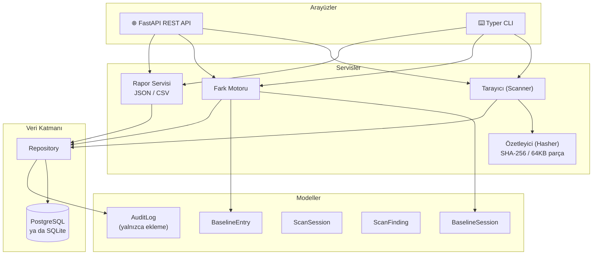

<div align="center">

# 🛡️ Dosya Bütünlüğü İzleme (FIM-Sentinel)

**Dosya Bütünlüğü İzleme ve Adli Bilişim Aracı**

[](https://www.python.org/)
[](https://fastapi.tiangolo.com/)
[](https://www.sqlalchemy.org/)
[](https://github.com/hasancrlk/dosya-butunlugu-izleme/actions/workflows/ci.yml)
[](LICENSE)
[](Dockerfile)

*İmzalı temel kayıtlar, kurcalanınca belli olan denetim kaydı, REST API ve komut satırı aracıyla dosya bütünlüğü izleme.*

</div>

---

## 🧭 Kısaca: Bu Proje Ne İşe Yarar?

Bir sunucuya sızan saldırgan genellikle iz bırakır. Bir web sayfasının içine
zararlı kod ekler, sunucuya bir "web shell" (`shell.php`) yükler ya da bir
yapılandırma dosyasını değiştirir. Bu değişiklikler çoğu zaman haftalarca
fark edilmez.

Bu araç izlemek istediğiniz klasörün o anki hâlinin **parmak izini** çıkarır.
Bu kayda "temel kayıt" (baseline) denir. Her dosyanın SHA-256 özeti, boyutu,
izinleri ve sahibi kaydedilir. Daha sonra aynı klasör yeniden taranır ve
temel kayıtla karşılaştırılır. Sonuçta şu üç soru cevaplanır:

- **Hangi dosyalar değişti?** (`MODIFIED`)
- **Hangi dosyalar sonradan eklendi?** (`ADDED`)
- **Hangi dosyalar silindi?** (`DELETED`)

Akıllı bir saldırgan izini silmek için temel kaydı da değiştirmeye çalışır.
Bu yüzden temel kayıtlar gizli bir anahtarla **imzalanır**. Veritabanında
elle değiştirilmiş bir temel kayıt tarama sırasında reddedilir. Yapılan her
işlem de silinemeyen, sırası bozulamayan bir **denetim kaydına** (audit log)
yazılır. Adli bilişimde bu özelliğe "delil zinciri" (chain of custody)
denir.

**Kimin işine yarar?** Web sunucusunda izinsiz değişiklik yakalamak isteyen
sistem yöneticilerinin, olay müdahalesi (incident response) yapan
ekiplerin ve dosya bütünlüğü izlemenin (FIM) nasıl çalıştığını öğrenmek
isteyenlerin.

| Siz verirsiniz | Araç size verir |
|---|---|
| İzlenecek klasör (`/var/www/html`) | İmzalı temel kayıt (her dosyanın özeti, boyutu, izni, sahibi) |
| Daha sonra "şimdi tara" komutu | Değişen, eklenen ve silinen dosyaların listesi |
| Rapor isteği | JSON ya da CSV rapor, değişiklik varsa çıkış kodu `2` (cron/CI uyarısı için) |

### ⚡ 3 Adımda Kullanım

1. **Kurun:** aşağıdaki [Hızlı Başlangıç](#-hızlı-başlangıç) bölümündeki
   komutlar. `.env` dosyasında `FIM_HMAC_KEY` değerini en az 32 karakterlik
   rastgele bir değerle değiştirmeyi unutmayın.
2. **Klasörün temel kaydını alın:**
   ```bash
   python -m cli.fim_cli baseline --path /var/www/html
   ```
3. **Bir süre sonra tarayın.** Dosyalarda değişiklik varsa tablo halinde
   görürsünüz:
   ```bash
   python -m cli.fim_cli scan --baseline-id 1
   ```

---

## 📋 İçindekiler

- [Genel Bakış](#-genel-bakış)
- [Mimari](#-mimari)
- [Delil Zinciri](#-delil-zinciri)
- [Hızlı Başlangıç](#-hızlı-başlangıç)
- [Komut Satırı (CLI) Kullanımı](#️-komut-satırı-cli-kullanımı)
- [API Kullanımı](#-api-kullanımı)
- [Docker ile Kurulum](#-docker-ile-kurulum)
- [Testler](#-testler)
- [Yapılandırma](#️-yapılandırma)
- [Proje Yapısı](#-proje-yapısı)
- [Katkıda Bulunma](#-katkıda-bulunma)

---

## 🏗 Genel Bakış

FIM-Sentinel, dosya sistemini izinsiz değişikliklere karşı izler. Önce
kriptografik bir temel kayıt oluşturur, sonra bu kayda göre değiştirilen,
eklenen ve silinen dosyaları tespit eder. Adli bütünlüğü korumak için her
işlem **yalnızca eklenebilen** (append-only) bir denetim kaydına yazılır.

### Temel Özellikler

| Özellik | Açıklama |
|---|---|
| 🔐 **Parçalı SHA-256 özeti** | Dosya 64 KB'lık parçalar hâlinde okunur, gigabaytlık dosyalarda bile bellek şişmez |
| 🔄 **Fark motoru** | Temel kayda göre `MODIFIED`, `ADDED`, `DELETED` değişikliklerini bulur |
| ✍️ **İmzalı temel kayıt** | HMAC-SHA256 imzası. Elle değiştirilen temel kayıt reddedilir (HTTP 409) |
| 📝 **Zincirli denetim kaydı** | Her satır bir öncekine bağlı. Silinen, değiştirilen ya da yeri değişen satır zinciri kırar |
| 🐘 **PostgreSQL + SQLite** | Canlı ortamda PostgreSQL, geliştirmede SQLite |
| 🌐 **REST API** | FastAPI, OpenAPI belgesi, JSON/CSV dışa aktarım, `X-API-Key` ile korumalı |
| ⌨️ **Komut satırı aracı** | Typer tabanlı, Rich ile renkli tablo çıktısı |
| 🐳 **Docker** | Çok aşamalı imaj, docker-compose ile uygulama + PostgreSQL |
| 🛡️ **Sağlam hata yönetimi** | Sembolik bağlantı döngüleri ve izin hataları kaydedilir, program çökmez |

---

## 🧭 Mimari



---

## 🔗 Delil Zinciri

> **Bu neden önemli?**
>
> Dijital adli bilişimde ve olay müdahalesinde **delil zinciri** (chain of
> custody), delilin sonradan kurcalanmadığını kanıtlamak demektir.
> FIM-Sentinel bunu beş yolla sağlar:
>
> 1. **Kriptografik özetler:** Her dosya için SHA-256 içerik özetinin yanında
>    boyut, izinler ve sahiplik bilgisi de tutulur.
> 2. **İmzalı temel kayıtlar:** Her temel kayıt `FIM_HMAC_KEY` ile
>    HMAC-SHA256 olarak imzalanır. Veritabanında değiştirilmiş bir temel kayıt
>    tarama anında reddedilir (HTTP 409) ve bu girişim denetim kaydına yazılır.
> 3. **Kurcalanınca belli olan denetim kaydı:** Her satır HMAC ile bir önceki
>    satıra zincirlenir. Satır düzenlemek, silmek ya da yerini değiştirmek
>    zinciri kırar. Kontrol için `GET /api/v1/audit/verify` ya da
>    `python -m cli.fim_cli verify-audit` kullanılır. PostgreSQL'de ayrıca bir
>    tetikleyici (trigger) UPDATE/DELETE işlemlerini engeller.
> 4. **Sembolik bağlantıya karşı güvenli tarama:** Bağlantılar takip
>    edilmez, hedefleriyle kaydedilir. Bir bağlantının başka yere
>    yönlendirilmesi değişiklik olarak yakalanır ve izlenen klasörün dışındaki
>    hiçbir dosya okunmaz.
> 5. **Yanlış "silindi" uyarısı yok:** Var olan ama okunamayan dosyalar
>    `DELETED` olarak değil, hata olarak raporlanır.
>
> ⚠️ `FIM_HMAC_KEY` değerini izlenen sunucunun veritabanından ayrı bir yerde
> (örneğin bir sır yöneticisinde) saklayın. Hem veritabanını hem anahtarı ele
> geçiren bir saldırgan temel kaydı sahteleyebilir.

---

## 🚀 Hızlı Başlangıç

### Gereksinimler

- Python 3.12+
- PostgreSQL 16+ *(isteğe bağlı, varsayılan olarak SQLite kullanılır)*

### Kurulum

```bash
# Depoyu klonlayın
git clone https://github.com/hasancrlk/dosya-butunlugu-izleme.git
cd dosya-butunlugu-izleme

# Sanal ortam oluşturun
python -m venv .venv
source .venv/bin/activate  # Linux/macOS
# .venv\Scripts\activate   # Windows

# Bağımlılıkları yükleyin
pip install -r requirements-dev.txt

# Ortam dosyasını kopyalayın (FIM_API_KEY ve FIM_HMAC_KEY'i değiştirin)
cp .env.example .env

# Veritabanını hazırlayın
python -c "from app.db.session import init_db; init_db()"

# API sunucusunu başlatın
uvicorn app.main:app --reload
```

Rastgele, güçlü bir anahtar üretmek için:

```bash
python -c "import secrets; print(secrets.token_urlsafe(48))"
```

---

## ⌨️ Komut Satırı (CLI) Kullanımı

```bash
# Bir klasörün temel kaydını alın
python -m cli.fim_cli baseline --path /var/www/html

# Bütünlük taraması yapın
python -m cli.fim_cli scan --baseline-id 1

# Raporu JSON olarak alın
python -m cli.fim_cli report --scan-id 1 --format json

# Raporu CSV dosyasına yazın
python -m cli.fim_cli report --scan-id 1 --format csv > rapor.csv

# Denetim kaydı zincirinin sağlam olduğunu doğrulayın
python -m cli.fim_cli verify-audit
```

Paketi `pip install -e .` ile kurarsanız aynı komutlar kısaca
`fim-sentinel baseline …`, `fim-sentinel scan …` olarak da çalışır.

| Komut | Ne yapar |
|---|---|
| `baseline --path <klasör>` | Klasörün imzalı temel kaydını oluşturur. `--follow-symlinks` ile bağlantılar takip edilir |
| `scan --baseline-id <n>` | Klasörü yeniden tarar ve temel kayıtla karşılaştırır. Değişiklik varsa **çıkış kodu 2** |
| `report --scan-id <n> --format json\|csv` | Taramanın raporunu standart çıktıya yazar |
| `verify-audit` | Denetim kaydı zincirini baştan sona doğrular, kırık satırı gösterir |

### Örnek Çıktı

```
$ python -m cli.fim_cli scan --baseline-id 1
                    Scan #1 Results
┏━━━━━━━━━━┳━━━━━━━┓
┃ Metric   ┃ Count ┃
┡━━━━━━━━━━╇━━━━━━━┩
│ Modified │     2 │
│ Added    │     1 │
│ Deleted  │     0 │
│ Errors   │     0 │
└──────────┴───────┘
┏━━━━━━━━━━┳━━━━━━━━━━━━━━━━━━━━━━━━━━┳━━━━━━━━━━━━━━━━━━━━━━━━━━━┓
┃ Type     ┃ File Path                ┃ Detail                    ┃
┡━━━━━━━━━━╇━━━━━━━━━━━━━━━━━━━━━━━━━━╇━━━━━━━━━━━━━━━━━━━━━━━━━━━┩
│ MODIFIED │ /var/www/html/index.html │ Hash mismatch detected.   │
│ MODIFIED │ /var/www/html/config.php │ Hash mismatch detected.   │
│ ADDED    │ /var/www/html/shell.php  │ New file detected.        │
└──────────┴──────────────────────────┴───────────────────────────┘
```

Bu örnek tipik bir saldırı izi gösteriyor: `index.html` ve `config.php`
değişmiş, klasöre de `shell.php` adında yeni bir dosya eklenmiş.

### Düzenli tarama (cron)

`scan` komutu değişiklik bulunca `2` koduyla çıkar. Bu sayede cron ya da
CI işlerine kolayca uyarı bağlanabilir:

```bash
# Her saat başı tara, değişiklik varsa e-posta at
0 * * * * cd /opt/dosya-butunlugu-izleme && .venv/bin/python -m cli.fim_cli scan -b 1 \
  || echo "Dosya bütünlüğü uyarısı" | mail -s "FIM uyarısı" yonetici@ornek.com
```

---

## 🌐 API Kullanımı

### Temel adres

```
http://localhost:8000
```

`/health` ve `/docs` dışındaki bütün uçlar `X-API-Key` başlığı ister.
API yalnızca `FIM_ALLOWED_PATHS` içinde listelenen klasörleri tarayabilir.

### Uçlar

| Metot | Uç | Açıklama |
|--------|----------|-------------|
| `GET` | `/health` | Sağlık kontrolü |
| `GET` | `/docs` | OpenAPI (Swagger) belgesi |
| `POST` | `/api/v1/baseline` | Temel kayıt oluşturur |
| `POST` | `/api/v1/scan` | Temel kayda göre bütünlük taraması yapar |
| `GET` | `/api/v1/reports/{scan_id}` | Tarama raporunu verir (JSON/CSV) |
| `GET` | `/api/v1/audit/verify` | Denetim kaydı zincirini doğrular |

### curl örnekleri

```bash
# Sağlık kontrolü
curl http://localhost:8000/health

# Temel kayıt oluştur
curl -H "X-API-Key: $FIM_API_KEY" -X POST http://localhost:8000/api/v1/baseline \
  -H "Content-Type: application/json" \
  -d '{"target_path": "/var/www/html"}'

# Tarama yap
curl -H "X-API-Key: $FIM_API_KEY" -X POST http://localhost:8000/api/v1/scan \
  -H "Content-Type: application/json" \
  -d '{"baseline_id": 1}'

# Raporu al (JSON)
curl -H "X-API-Key: $FIM_API_KEY" http://localhost:8000/api/v1/reports/1

# Raporu al (CSV)
curl -H "X-API-Key: $FIM_API_KEY" "http://localhost:8000/api/v1/reports/1?format=csv" -o rapor.csv

# Denetim kaydını doğrula
curl -H "X-API-Key: $FIM_API_KEY" http://localhost:8000/api/v1/audit/verify
```

---

## 🐳 Docker ile Kurulum

```bash
# Önce sırları ayarlayın (API anahtarı, HMAC anahtarı, PostgreSQL parolası)
cp .env.example .env && $EDITOR .env

# Derleyip başlatın (uygulama + PostgreSQL; migration'lar otomatik çalışır)
docker compose up -d --build

# Günlükleri izleyin
docker compose logs -f fim-sentinel

# Durdurun
docker compose down
```

API `127.0.0.1:8000` adresinde dinler. PostgreSQL ana makineye açılmaz.

İzlenecek klasörü bağlamak için:

```bash
# docker-compose.yml içinde ./watch klasörü konteynerde /watch olarak bağlı
mkdir -p watch
cp -r /izlenecek/klasor/* watch/

# Ardından temel kaydını alın
curl -H "X-API-Key: $FIM_API_KEY" -X POST http://localhost:8000/api/v1/baseline \
  -d '{"target_path": "/watch"}' \
  -H "Content-Type: application/json"
```

---

## 🧪 Testler

```bash
# Bütün testleri çalıştırın
pytest tests/ -v

# Kısa hata çıktısıyla
pytest tests/ -v --tb=short

# Tek bir modülü çalıştırın
pytest tests/test_hasher.py -v
pytest tests/test_diff_engine.py -v
pytest tests/test_api.py -v
```

### Test kapsamı

| Modül | Sınananlar |
|--------|-------|
| `hasher.py` | Bilinen özet, boş ve büyük dosya, izin reddi, olmayan dosya, sembolik bağlantı, izin bilgisinin toplanması |
| `scanner.py` | Dosya sayımı, özet doğrulama, olmayan klasör, boş klasör |
| `diff_engine.py` | Değişen/eklenen/silinen, okunamayan ≠ silinen, izin değişikliği, bağlantı hedefinin değişmesi |
| `API` | Uçtan uca akış, kimlik doğrulama, klasör izin listesi, kurcalanmış temel kayıt (409), denetim zinciri doğrulaması |

---

## ⚙️ Yapılandırma

Tüm ayarlar `FIM_` önekli ortam değişkenlerinden ya da `.env` dosyasından okunur.

| Değişken | Varsayılan | Açıklama |
|----------|---------|-------------|
| `FIM_DATABASE_URL` | `sqlite:///./fim_sentinel.db` | Veritabanı bağlantı adresi |
| `FIM_HASH_CHUNK_SIZE` | `65536` | Parçalı özet için parça boyutu (bayt) |
| `FIM_FOLLOW_SYMLINKS` | `false` | Taramada sembolik bağlantıları takip et |
| `FIM_LOG_LEVEL` | `INFO` | Günlük seviyesi |
| `FIM_API_KEY` | — (**API için zorunlu**) | `X-API-Key` başlığında beklenen değer |
| `FIM_HMAC_KEY` | — (**zorunlu**, ≥32 karakter) | Temel kayıtları ve denetim zincirini imzalar |
| `FIM_ALLOWED_PATHS` | `[]` | API'nin tarayabileceği klasörlerin JSON listesi |

> `scan` komutu değişiklik bulduğunda **2** koduyla çıkar. Böylece cron
> işleri ya da CI uyarıları doğrudan bu koda bağlanabilir.

---

## 📁 Proje Yapısı

```
dosya-butunlugu-izleme/
├── app/
│   ├── api/v1/endpoints/   # FastAPI uç işleyicileri
│   ├── db/                 # Motor, oturum, repository
│   ├── models/             # SQLAlchemy ORM modelleri
│   ├── schemas/            # Pydantic istek/yanıt şemaları
│   ├── services/           # Asıl iş mantığı (özet, tarama, fark, imza, rapor)
│   ├── config.py           # Pydantic Settings
│   └── main.py             # FastAPI uygulama fabrikası
├── cli/                    # Typer komut satırı aracı
├── alembic/                # Veritabanı migration'ları
├── tests/                  # Pytest test takımı
├── Dockerfile              # Çok aşamalı Docker imajı
├── docker-compose.yml      # Uygulama + PostgreSQL
└── README.md
```

---

## 🤝 Katkıda Bulunma

1. Depoyu fork'layın
2. Yeni bir dal açın (`git checkout -b ozellik/yeni-ozellik`)
3. Değişikliklerinizi commit'leyin (`git commit -m 'Yeni özellik eklendi'`)
4. Dalınızı gönderin (`git push origin ozellik/yeni-ozellik`)
5. Bir Pull Request açın

---

## 📄 Lisans

MIT Lisansı ile dağıtılmaktadır. Ayrıntılar için [LICENSE](LICENSE) dosyasına bakın.
